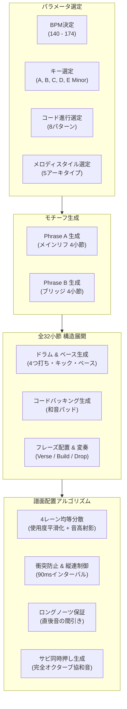
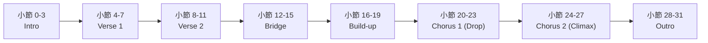
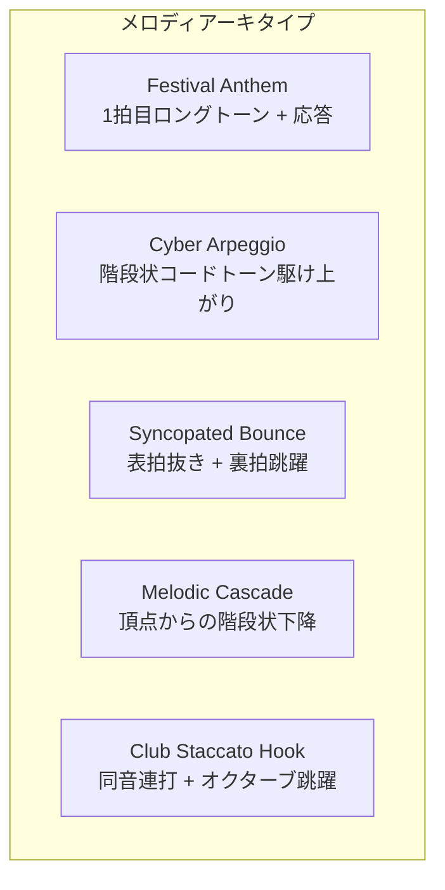
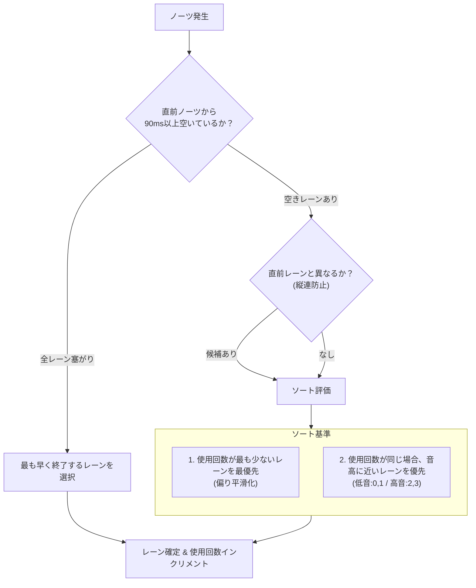
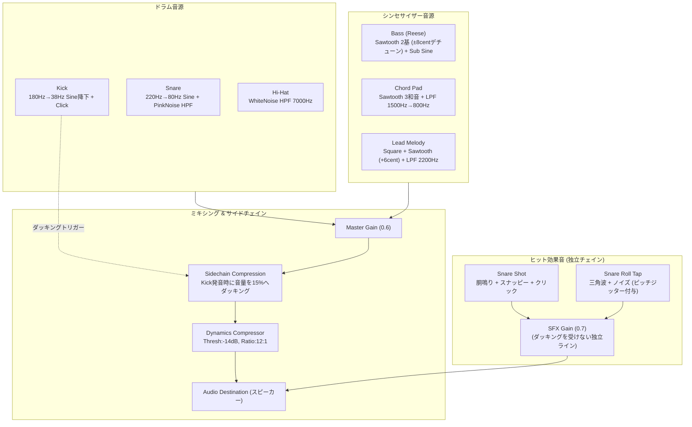

# 音楽・ノーツ生成アルゴリズムとルール仕様書

本ドキュメントは、本ゲームにおける完全プロシージャル（手続き型自動生成）音楽およびリズムゲーム譜面の生成アルゴリズム、音楽理論に基づくルール体系、Web Audio API音響合成アーキテクチャをまとめた技術仕様書です。

---

## 1. 全体アーキテクチャ

楽曲と譜面の生成は、外部のプリレンダリング済み音声ファイル（MP3/WAV等）や事前作成された譜面データに依存せず、ブラウザ起動時およびリスタート時に乱数シードから数学的・音楽理論的にリアルタイム生成されます。

---

## 2. 楽曲構造と展開パイプライン

### 2.1 基礎パラメータ決定
曲の開始時に以下の要素が決定されます。

- **テンポ (BPM)**: 140〜174 の範囲で整数値をランダム選定。8分音符単位（サブビート）のミリ秒間隔 `subBeatTime = 60000 / bpm / 2` を基準クロックとして全イベントを計算します。
- **ルート音 (Key)**: A Minor (57), B Minor (59), C Minor (60), D Minor (62), E Minor (64) の5つのナチュラル・マイナースケールから選定。
- **スケール展開**: 選択されたルート音からナチュラル・マイナーの音程比 `[0, 2, 3, 5, 7, 8, 10]` を適用し、3オクターブ分（計21音）のMIDI番号配列 `scaleExt` を展開します。

### 2.2 8種類のコード進行パターン
楽曲の調和構造を決定づける4小節周期のコード進行は、以下の8パターンから選出されます。

| コード進行 (ディグリー) | 特徴と音楽的効果 |
| :--- | :--- |
| `VI - VII - i - i` | 小室進行風。疾走感と哀愁が共存する王道ダンスナンバー |
| `iv - v - i - i` | EDM定番進行。力強い解決感とグルーヴを生み出す |
| `i - VI - III - VII` | 王道進行。メロディアスで壮大なスケール感を提供 |
| `VI - VII - III - i` | カノン派生進行。感情的な起伏とドラマチックな旋律に適合 |
| `i - III - iv - v` | ステップ上昇進行。前向きにビルドしていくドライブ感 |
| `i - VII - VI - VII` | 哀愁アンダルシア進行。フラメンコ調の切ない情熱を表現 |
| `VI - i - III - VII` | エモーショナル進行。切なさと浮遊感が際立つ展開 |
| `iv - i - v - v` | フューチャーベース進行。モダンでドリーミーな世界観 |

### 2.3 全32小節の構成ドラマツルギー
楽曲はダンスミュージックの構造美に準拠した32小節（4小節 × 8ブロック）で編成されます。

- **Intro (0〜3小節)**: キック、ベース、ハイハットのみ。譜面ノーツは出ず、プレイヤーがリズムを掴む時間。
- **Verse 1 (4〜7小節)**: メインフレーズ（Phrase A）が中音域で初提示。
- **Verse 2 (8〜11小節)**: Phrase A の音程をわずかに変調させた変奏。
- **Bridge (12〜15小節)**: 落ち着いた別メロディ（Phrase B）。音数を間引き、サビ前の静けさを演出。
- **Build-up (16〜19小節)**: スネアロールが加速。Phrase A の頭音を用いたスタッター（細分化連打）が展開。
- **Chorus 1 / Drop (20〜23小節)**: Phrase A が1オクターブ上（+7スケールステップ = +12半音）で豪快に大復活。完全協和音の同時押しノーツが登場。
- **Chorus 2 (24〜27小節)**: 音程をさらに2段階持ち上げた最高潮クライマックス。
- **Outro (28〜31小節)**: Phrase A の前半のみが演奏され、余韻を残してフェードアウト。

---

## 3. メロディ生成アルゴリズム

何回遊んでも単調にならないよう、楽曲ごとに5つの「メロディスタイル（アーキタイプ）」から1つを選定し、モチーフをプロシージャル生成します。

### 3.1 5つのメロディスタイル

1. **Festival Anthem**:
   - 奇数小節の1拍目に堂々としたロングトーンを打ち出し、後半拍でコール＆レスポンスを展開する王道EDMスタイル。
2. **Cyber Arpeggio**:
   - 8分音符でコードトーンを階段状に駆け上がる流麗かつ疾走感あふれるシーケンス。
   - 3種類のアルペジオ進行パターン（`[0,1,2,1,2,0,1]`等）からランダム選択。
3. **Syncopated Bounce**:
   - 表拍（0拍目）をあえて休符とし、裏拍（1, 2, 4, 5, 7サブビート）で跳ね回るファンキーなグルーヴ。
4. **Melodic Cascade**:
   - 高音（スケールインデックス7〜8）の頂点音から階段状に駆け下りて着地するドラマチックな旋律線。
5. **Club Staccato Hook**:
   - 同一のコード根音を小刻みに連打し、小節末尾で5度またはオクターブ上へ跳躍するキャッチーなクラブフック。

### 3.2 聴覚疲労を防ぐ音域制限
生成されたメロディは、サビ（Chorus）で1オクターブ（+12半音）引き上げられます。その際、超高周波成分（2000Hz超）による耳への刺さりや不快感を防ぐため、以下のガードレールが適用されます。

- **MIDI 84 (1046.5Hz, C6) 上限クリッピング**: MIDI番号が84を超える音は、自動的に1オクターブ下（`-12`）へトランスポーズ。
- 常に抜けの良い、耳に心地よいリードシンセ帯域（C4〜C6）に維持されます。

---

## 4. ノーツ譜面生成と配置ルール

プレイヤーがストレスなく爽快に打鍵できるよう、音楽と連動した厳密な譜面配置ルールを定めています。

### 4.1 4レーン均等分散アルゴリズム
特定のレーンに偏ったり、不自然な連続打鍵（縦連）が発生したりするのを防ぐため、以下の手順でレーンを決定します。

### 4.2 ロングノーツ（ホールド）の保証と安全間引き
- **最低出現数の保証**: 1フレーズあたり最低4個のロングノーツを保証。不足している場合は強拍（小節頭）の通常ノーツを優先的にロングノーツへ昇格。
- **持続時間の最適化**: 持続時間は最低1拍分（`beatTime * 1.0`）、最大1.5拍分に設定。
- **直後ノーツの間引き**: ロングノーツの直後（1サブビート後）に別のノーツが存在するとホールド完了前に次の打鍵が衝突するため、直後のノーツを自動的に間引き、悠々とホールドできる余白を確保。

### 4.3 サビにおける協和音ダブルノーツ（同時押し）
- **オクターブ協和音**: サビ（Chorus）の小節頭（1拍目または裏拍アタック）で同時押しノーツを生成。不協和音を徹底排除するため、2音目のピッチは主音の「完全オクターブ（±12半音）」に固定。
- **両手分担配置**: 叩きやすさと爽快感を両立するため、反対側の手（レーン0に対してレーン2、レーン1に対してレーン3）にペアノーツを配置。

### 4.4 多彩なサビ前ビルドアップ（4種類の助走スタイル）
サビ前（16〜19小節）の展開が毎回同じテンポ倍速連打にならないよう、楽曲生成ごとに以下の4つの助走スタイルからランダム選定されます：

1. **Breakdown（静寂のブレイクダウン）**:
   - キック・スネア・ベースを完全カット（音抜き）。コードパッドとロングトーンメロディが優雅に広がり、サビ直前の1拍にだけスネア1打フィルインが鳴ってサビで大爆発。
2. **Syncopated Tease（シンコペーション助走）**:
   - テンポを倍速にせず、4つ打ちキックと裏拍グルーヴをキープしたままメインフレーズの変奏を展開。
3. **Half-time（ハーフタイム）**:
   - テンポ感を半分（2拍に1音）に落とし、重厚なビートとタメを演出。サビで通常の疾走感に戻った瞬間のカタルシスを強調。
4. **Riser Rush（スッキリEDMスタッター）**:
   - 前半3小節は通常テンポを維持し、最後の1小節のみ8分音符で小気味よく駆け上がり、最後の1拍で静寂ブレイクを作る凝縮された連打。

### 4.5 1小節ごとの小節線（Bar Line）表示
ノーツの視認性とリズムの把握を支援するため、楽曲のBPMに同期して1小節（4拍）ごとに全レーンを横断する薄い水平ラインが降下します。
- **通常の小節線**: 白色の半透明ライン（`rgba(255, 255, 255, 0.22)`）。
- **フレーズ境界線**: 4小節ごとの区切り（セクション境界）は淡いネオンシアンで視覚的アクセントを付与。
- **通過フェードアウト**: 判定ラインを通過した後は即座に消滅せず、下方向に滑らかにフェードアウトしながら抜けていきます。

---

## 5. Web Audio API 音響合成アーキテクチャ

すべてのオーディオ信号は Web Audio API のオシレーター、バッファノイズ、フィルタ、エンベロープを用いて動的に合成されます。

### 5.1 サイドチェイン・ダッキング
キックドラムが発音された瞬間、`sidechainAmount` が瞬時に `0.15` に設定され、マスターゲインを急減衰させます。その後、フレームごとに `0.15` ずつ指数関数的に元の音量（1.0）へ滑らかに復帰します。これにより、EDM特有のうねるようなポンピング効果が生まれます。

### 5.2 打鍵ヒット音（SE）設計
- **短押しノーツ**: スネア単音ショット（胴鳴りピッチベンド + ピンクノイズスナッピー + アタッククリック）。判定（PERFECT / GREAT / GOOD）に応じてピッチと音量を変化。
- **長押しノーツ（ホールド中）**: 65ms間隔でスネア連打（スネアロール）効果音を発音。打撃ごとにランダムなピッチジッター（230〜270Hz）を付与し、機械的でないリアルなドラムロール感を演出。
- **ホールド完了**: アクセントスネアショットと同時に、サイン波チャイム（1046Hz → 2093Hz）が鳴り響きます。

---

## 6. 判定タイミングとスコアリング

打鍵タイミング（ミリ秒差 `diff`）に基づいてリアルタイム判定が行われます。

| 判定 | 許容誤差範囲 | 基礎スコア | エフェクト演出色 |
| :--- | :--- | :--- | :--- |
| **PERFECT** | `|diff| < 45ms` | 300点 | シアン (`#00e5ff`) |
| **GREAT** | `45ms <= |diff| < 90ms` | 150点 | ネオングリーン (`#00ff88`) |
| **GOOD** | `90ms <= |diff| < 140ms` | 70点 | イエロー (`#ffea00`) |
| **MISS** | `140ms` 超過 / 見逃し | 0点（コンボリセット） | グレー (`#787878`) |
| **HOLD TICK** | ホールド中 65ms ごと | 5点 / 回 | スパーク粒子連続放射 |
| **COMPLETE** | ロングノーツ完走 | 300点 | 放射状大爆発エフェクト |

ノーツ落下速度は `NOTE_SPEED = 600ms`（画面上部に出現してから判定ラインに到達するまでの所要時間）に設定されています。

